<!--
  Images in assets/ and the blocks between START/END markers are generated from profile.toml
  by scripts/build.py (the "Build profile" workflow). Edit profile.toml, not those blocks.
  Everything else in this file is safe to edit by hand.
-->

<picture><source media="(prefers-color-scheme: dark)" srcset="assets/header-dark.svg"><source media="(prefers-color-scheme: light)" srcset="assets/header-light.svg"></picture>

<picture><source media="(prefers-color-scheme: dark)" srcset="assets/typing-dark.svg"><source media="(prefers-color-scheme: light)" srcset="assets/typing-light.svg"></picture>

<!--LINKS:START-->

<!--LINKS:END-->

### About me

I'm a second-year B.Tech CSE (AI & ML) student at GLA University. I like building things people actually use: a phone line farmers can call to book a mandi slot, an internship search that filters out scam postings before you see them. Most of my projects start at hackathons, and the good ones keep going after the demo.

Outside my own code I run **Let's Cook**, a student-run tech community that holds workshops and hackathons for students across India.

**Right now**

- Turning InReal from a hackathon build into a real product: Google sign-in, Supabase backend
- Preparing for Google Summer of Code 2027
- Content Head at Star Club, GLA's AIML department club
- Finished AWS's *Introduction to Generative AI* course

### Featured work

<!--PROJECTS:START-->

<a href="https://github.com/abhishekgoswami0720/Team-RootCause----MandiQ----SIH-2026"><picture><source media="(prefers-color-scheme: dark)" srcset="assets/card-mandiq-dark.svg"><source media="(prefers-color-scheme: light)" srcset="assets/card-mandiq-light.svg"></picture></a>
<a href="https://github.com/abhishekgoswami0720/InReal"><picture><source media="(prefers-color-scheme: dark)" srcset="assets/card-inreal-dark.svg"><source media="(prefers-color-scheme: light)" srcset="assets/card-inreal-light.svg"></picture></a>

<a href="https://github.com/abhishekgoswami0720/NEXUS-Countdown"><picture><source media="(prefers-color-scheme: dark)" srcset="assets/card-nexus-countdown-dark.svg"><source media="(prefers-color-scheme: light)" srcset="assets/card-nexus-countdown-light.svg"></picture></a>
<a href="https://github.com/abhishekgoswami0720/Travel-Sim-Sales-Dashboard"><picture><source media="(prefers-color-scheme: dark)" srcset="assets/card-travel-sim-dashboard-dark.svg"><source media="(prefers-color-scheme: light)" srcset="assets/card-travel-sim-dashboard-light.svg"></picture></a>

live demos → <a href="https://frontend-omega-fawn-51.vercel.app/">MandiQ</a> · <a href="https://travel-sim-sales-dashboard-nine.vercel.app">Travel SIM Dashboard</a>

<!--PROJECTS:END-->

### Toolbox

<!--STACK:START-->

<a href="https://skillicons.dev"><picture><source media="(prefers-color-scheme: dark)" srcset="https://skillicons.dev/icons?i=py,js,ts,html,css,react,nodejs,express,fastapi,flask,threejs,vite,mongodb,postgres,sqlite,supabase,git,github,vercel,aws&perline=10&theme=dark"><source media="(prefers-color-scheme: light)" srcset="https://skillicons.dev/icons?i=py,js,ts,html,css,react,nodejs,express,fastapi,flask,threejs,vite,mongodb,postgres,sqlite,supabase,git,github,vercel,aws&perline=10&theme=light"></picture></a>

<!--STACK:END-->

### The road so far

<picture><source media="(prefers-color-scheme: dark)" srcset="assets/timeline-dark.svg"><source media="(prefers-color-scheme: light)" srcset="assets/timeline-light.svg"></picture>

### On GitHub

<picture><source media="(prefers-color-scheme: dark)" srcset="assets/stats-dark.svg"><source media="(prefers-color-scheme: light)" srcset="assets/stats-light.svg"></picture>
<picture><source media="(prefers-color-scheme: dark)" srcset="assets/languages-dark.svg"><source media="(prefers-color-scheme: light)" srcset="assets/languages-light.svg"></picture>

<picture><source media="(prefers-color-scheme: dark)" srcset="assets/activity-dark.svg"><source media="(prefers-color-scheme: light)" srcset="assets/activity-light.svg"></picture>

<picture><source media="(prefers-color-scheme: dark)" srcset="assets/snake-dark.svg"><source media="(prefers-color-scheme: light)" srcset="assets/snake-light.svg"></picture>

<picture><source media="(prefers-color-scheme: dark)" srcset="assets/footer-dark.svg"><source media="(prefers-color-scheme: light)" srcset="assets/footer-light.svg"></picture>

