<!--
  Images in assets/ and the blocks between START/END markers are generated from profile.toml
  by scripts/build.py (the "Build profile" workflow). Edit profile.toml, not those blocks.
  Everything else in this file is safe to edit by hand.
-->

<picture><source media="(prefers-color-scheme: dark)" srcset="assets/header-dark.svg"><source media="(prefers-color-scheme: light)" srcset="assets/header-light.svg"></picture>

<picture><source media="(prefers-color-scheme: dark)" srcset="assets/typing-dark.svg"><source media="(prefers-color-scheme: light)" srcset="assets/typing-light.svg"></picture>

<!--LINKS:START-->

<!--LINKS:END-->

### About me

I'm the **founder and executive chairman of [Let's Cook](https://letscook.co.in)**, a student-run tech
community, and a second-year B.Tech CSE (AI & ML) student at GLA University.

I like building things people actually use: a phone line farmers can call to book a mandi slot, an
internship search that removes scam posts before you see them, AI agents that tell you whether a job
offer is fake. Most of my projects start at hackathons. The good ones keep going after the demo.

<table>
<tr>
<td width="50%" valign="top">

**🍳 Building**

- **Let's Cook:** workshops, hackathon partnerships, and our first open-source project, CodeOrbit
- **InReal:** turning a hackathon build into a product, with Google sign-in and a Supabase backend
- **Jaanch:** three AI agents that score fake job and internship offers

</td>
<td width="50%" valign="top">

**🌱 Also**

- Preparing for **Google Summer of Code 2027**
- Co-head, Content & Design at **Star Club**, GLA's AIML club
- Sharing hackathons with **~900 students** in a WhatsApp community I run
- Finished AWS's *Introduction to Generative AI*

</td>
</tr>
</table>

### Let's Cook

<a href="https://letscook.co.in"><picture><source media="(prefers-color-scheme: dark)" srcset="assets/letscook-dark.svg"><source media="(prefers-color-scheme: light)" srcset="assets/letscook-light.svg"></picture></a>

We start with the basics most workshops skip, like Git and GitHub, and we keep mentoring hackathon teams
after the results, not just the winners. Want Let's Cook at your college or as a community partner for your
hackathon? Reach out through **[letscook.co.in](https://letscook.co.in)**, or come build with us on
**[GitHub](https://github.com/LetsCook-Organization)**.

### Featured work

<!--PROJECTS:START-->

<a href="https://github.com/abhishekgoswami0720/MandiQ"><picture><source media="(prefers-color-scheme: dark)" srcset="assets/card-mandiq-dark.svg"><source media="(prefers-color-scheme: light)" srcset="assets/card-mandiq-light.svg"></picture></a>
<a href="https://github.com/abhishekgoswami0720/InReal"><picture><source media="(prefers-color-scheme: dark)" srcset="assets/card-inreal-dark.svg"><source media="(prefers-color-scheme: light)" srcset="assets/card-inreal-light.svg"></picture></a>

<a href="https://github.com/abhishekgoswami0720/jaanch"><picture><source media="(prefers-color-scheme: dark)" srcset="assets/card-jaanch-dark.svg"><source media="(prefers-color-scheme: light)" srcset="assets/card-jaanch-light.svg"></picture></a>
<a href="https://github.com/LetsCook-Organization/CodeOrbit"><picture><source media="(prefers-color-scheme: dark)" srcset="assets/card-codeorbit-dark.svg"><source media="(prefers-color-scheme: light)" srcset="assets/card-codeorbit-light.svg"></picture></a>

<a href="https://github.com/abhishekgoswami0720/NEXUS-Countdown"><picture><source media="(prefers-color-scheme: dark)" srcset="assets/card-nexus-countdown-dark.svg"><source media="(prefers-color-scheme: light)" srcset="assets/card-nexus-countdown-light.svg"></picture></a>
<a href="https://github.com/abhishekgoswami0720/Travel-Sim-Sales-Dashboard"><picture><source media="(prefers-color-scheme: dark)" srcset="assets/card-travel-sim-dashboard-dark.svg"><source media="(prefers-color-scheme: light)" srcset="assets/card-travel-sim-dashboard-light.svg"></picture></a>

live demos → <a href="https://frontend-omega-fawn-51.vercel.app/">MandiQ</a> · <a href="https://codeorbit-c7q4.onrender.com/">CodeOrbit</a> · <a href="https://travel-sim-sales-dashboard-nine.vercel.app">Travel SIM Dashboard</a>

<!--PROJECTS:END-->

### Toolbox

<!--STACK:START-->

<a href="https://skillicons.dev"><picture><source media="(prefers-color-scheme: dark)" srcset="https://skillicons.dev/icons?i=py,js,ts,html,css,react,nodejs,express,fastapi,flask,threejs,vite,mongodb,postgres,sqlite,supabase,git,github,vercel,aws&perline=10&theme=dark"><source media="(prefers-color-scheme: light)" srcset="https://skillicons.dev/icons?i=py,js,ts,html,css,react,nodejs,express,fastapi,flask,threejs,vite,mongodb,postgres,sqlite,supabase,git,github,vercel,aws&perline=10&theme=light"></picture></a>

<!--STACK:END-->

### The road so far

<picture><source media="(prefers-color-scheme: dark)" srcset="assets/timeline-dark.svg"><source media="(prefers-color-scheme: light)" srcset="assets/timeline-light.svg"></picture>

### On GitHub

<picture><source media="(prefers-color-scheme: dark)" srcset="assets/stats-dark.svg"><source media="(prefers-color-scheme: light)" srcset="assets/stats-light.svg"></picture>
<picture><source media="(prefers-color-scheme: dark)" srcset="assets/languages-dark.svg"><source media="(prefers-color-scheme: light)" srcset="assets/languages-light.svg"></picture>

<picture><source media="(prefers-color-scheme: dark)" srcset="assets/activity-dark.svg"><source media="(prefers-color-scheme: light)" srcset="assets/activity-light.svg"></picture>

<picture><source media="(prefers-color-scheme: dark)" srcset="assets/snake-dark.svg"><source media="(prefers-color-scheme: light)" srcset="assets/snake-light.svg"></picture>

<picture><source media="(prefers-color-scheme: dark)" srcset="assets/footer-dark.svg"><source media="(prefers-color-scheme: light)" srcset="assets/footer-light.svg"></picture>

